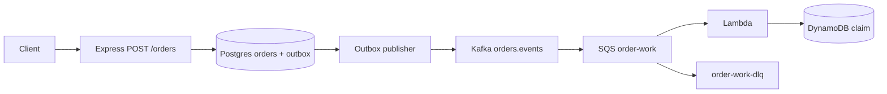
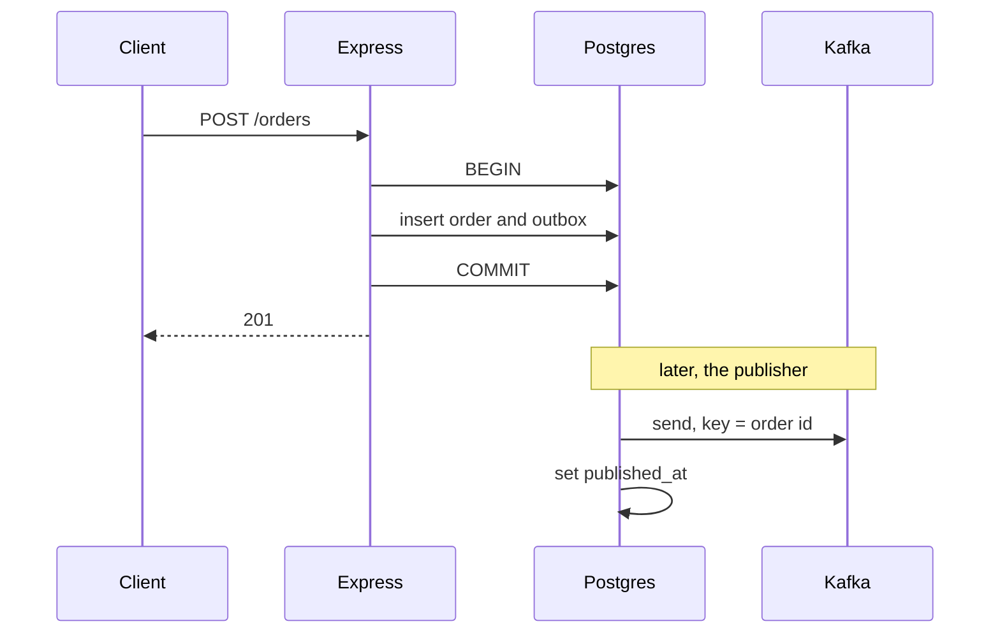

# Serverless order pipeline

Express takes the order. Postgres stores the order and an outbox row in one transaction. A publisher copies unpublished rows to Kafka with the order id as the key. A separate worker claims each event in DynamoDB and runs the side effect from SQS, so a duplicate delivery does not run twice.

Kafka in this repo is Redpanda in Docker, not Amazon MSK. The HTTP API is a normal Node process, not a Lambda. Lambda is only the queue worker.

## Flow



## Placing an order



The send and the `published_at` update share one database transaction. If the send throws, the stamp rolls back and the row is still unpublished.

## Functional requirements

- Place an order with a sku, a quantity of at least 1, and an idempotency key.
- The sku is required and at most 80 characters.
- The same idempotency key returns the original order. The key may be in the body or the `Idempotency-Key` header. The body wins when both are set.
- The first response is 201. A replay is 200 with the same id.
- Every accepted order writes one `order.placed` outbox row in the same transaction as the order.
- The publisher sends unpublished rows to `orders.events`. The Kafka key is the order id.
- A failed send leaves `published_at` null.
- A second publish of an already published row sends nothing.
- `order.placed` is forwarded to the `order-work` queue. `order.failed` is forwarded to `order-failed`.
- The worker claims `eventId` in DynamoDB with `attribute_not_exists`. The side effect runs only for the winning claim.
- A thrown side effect is returned as an SQS batch item failure so that message is retried.
- After 5 receives the redrive policy moves the message to `order-work-dlq`.

## Non-functional requirements

- The order and its outbox row commit or roll back together.
- Two requests with the same idempotency key, including a race, end as one order. The loser of the unique-key insert reads the winner.
- Publishing is at least once. A crash after the broker ack and before the commit republishes the same outbox id. Consumers must treat that id as the idempotency key, which the worker does.
- The publisher locks a batch with `FOR UPDATE SKIP LOCKED`, so two publishers do not send the same row.
- The API does not call Kafka on the request path.
- No latency SLO is claimed. The tests check correctness, not timing.

## System design

The write model is the order aggregate. The outbox is the integration contract. Express owns the transaction because the client is waiting on the write, and a Lambda in front of that write would not make the transaction simpler.

The worker is the part that fits Lambda: one message, a conditional write, a side effect, then ack or retry. The claim table is DynamoDB because the condition is a single-item put, not a relational query.

`infra/template.yaml` is the deploy description: the effect table, `order-work` with `maxReceiveCount: 5`, the dead-letter queue, `order-failed`, and a Node.js 22 function with `ReportBatchItemFailures`.

## Technologies

- Node.js 22, TypeScript, Express
- PostgreSQL, Prisma
- KafkaJS, Redpanda in Docker for local Kafka
- AWS Lambda, SQS, DynamoDB, described in SAM
- Docker, GitHub Actions

## Layout

```
src/domain            order rules
src/application       place, publish ports, forward, claim, work
src/infrastructure    Prisma, Kafka, in-memory queue, DynamoDB claim
src/interfaces/http   Express
src/interfaces/lambda SQS handler
infra/template.yaml   queues, table, function
```

## API

```bash
curl -s -X POST http://127.0.0.1:3001/orders \
  -H 'content-type: application/json' \
  -H 'idempotency-key: order-1001' \
  -d '{"sku":"mug","qty":1}'
```

`GET /health` returns `{ "ok": true }`. A bad body returns 400.

## How to run

```bash
createdb orders_test
cp .env.example .env
npm install
npx prisma generate
npx prisma migrate deploy
npm test
npm run dev
```

`npm run dev` listens on `PORT` (default 3001). `npm run publish` sends unpublished outbox rows. `OUTBOX_BATCH` defaults to 20.

Postgres for the app is local, or the Compose file:

```bash
docker compose up -d
```

That starts Postgres on host port 54329 and Redpanda on 9092. Point `DATABASE_URL` at the Compose database if you use it. The unit tests use the database in `.env`, which defaults to a local `orders_test` database.

Forward one event without a broker:

```bash
npx tsx src/forward-main.ts '{"id":"1","type":"order.placed","orderId":"ord_1"}'
```

## How to test

```bash
npm run typecheck
npm test
```

GitHub Actions runs the same steps against Postgres 16. The job is capped at 15 minutes.

## How to deploy

Build the API image:

```bash
docker build -t order-api .
```

The image starts `src/main.ts`. Run the publisher as a second process with the same image and `npx tsx src/publish-main.ts`.

The worker is the SAM stack:

```bash
sam build --template infra/template.yaml
sam deploy --guided
```

The function handler exported for production wiring is `handleOrderWork`. It expects the caller to pass an effect claim and the side effect. The template names the DynamoDB table, the queues, and the redrive policy. A live deploy still needs the function entrypoint to construct `dynamoEffects` with `EFFECT_TABLE`. The tests cover the handler with `MemoryEffects` and a fake DynamoDB client that throws `ConditionalCheckFailedException`.

## What a failure looks like

| Failure | What the code does |
| --- | --- |
| Quantity below 1, empty sku, sku over 80 | 400, nothing written |
| Crash inside the order transaction | order and outbox both gone |
| Broker down during publish | row stays unpublished, the error propagates |
| Same event delivered twice to the worker | second claim returns false, side effect does not run |
| Side effect throws | message id is a batch item failure and SQS retries |
| Receive count above 5 | message is eligible for `order-work-dlq` |
